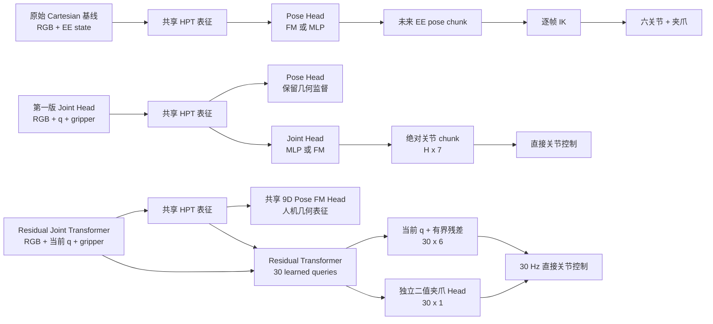
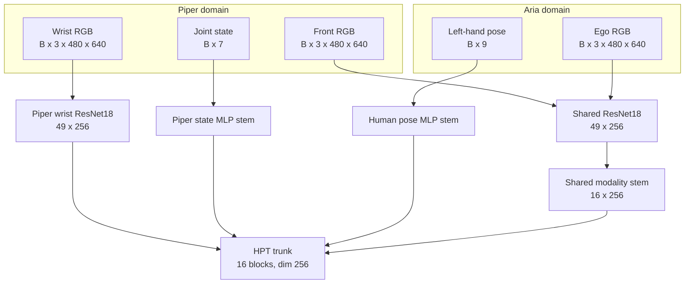
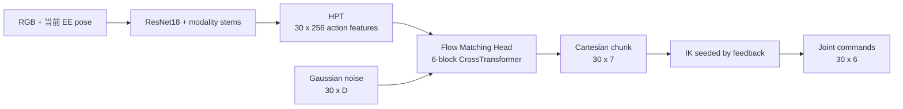
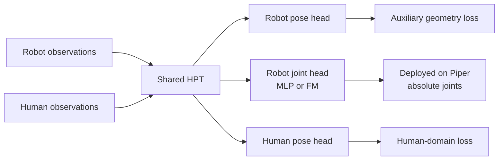
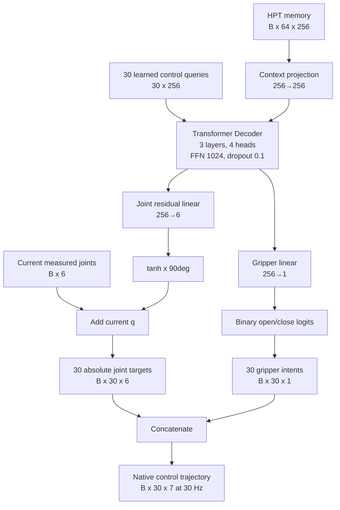
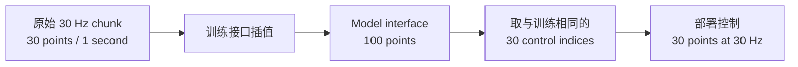
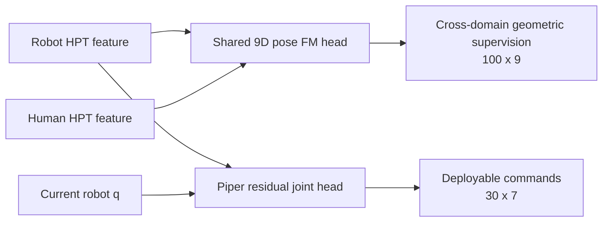
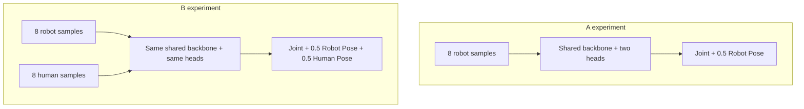

# 从初版 EgoVerse 适配到 Residual Joint Transformer：Piper 模型结构与数据流演进

本文解释本项目中“最初的模型”和“目前的模型”到底差在哪里。这里需要先澄清一个容易混淆的历史事实：我们的起点不是一个模型，而是两个连续阶段。

1. **原始 Cartesian 基线**：沿用 EgoVerse/HPT 的基本思路，由策略预测末端位姿，再通过 IK 得到关节角。
2. **第一版 Joint Head**：保留 HPT 表征，在下游增加 Piper 专用关节头，先后尝试 MLP 与 Flow Matching，绕过部署时的 IK。
3. **目前的 Residual Joint Transformer**：仍然保留共享 HPT 和跨域 9D pose 监督，但将真正部署的 Piper head 改成“当前关节状态条件下的 residual Transformer”，并重新定义时间轴、夹爪标签和物理损失。

所以，Residual Joint Transformer 并不是简单地把 MLP 换成 Transformer。它改变的是策略输出问题本身：第一版在问“未来每一帧的绝对关节角是什么”，Residual Joint Transformer 在问“从当前真实关节状态出发，未来 1 秒应当产生怎样的平滑关节残差，并在什么时候切换夹爪状态”。

---

## 1. 一张图看完整演进



三代方案中，视觉编码器和 HPT 主干没有被推翻。真正发生变化的是 **action head、动作表示和训练目标**。

---

## 2. 三代模型共享的骨架

无论 A 组还是 B 组，核心视觉与表征网络都基于同一条 HPT 数据路径。

### 2.1 Piper 输入

单个 Piper 样本在当前任务中包含：

| 模态 | 原始规格 | 编码后规格 | 说明 |
|---|---:|---:|---|
| D435IF 主视角 RGB | `[B,3,480,640]` | `[B,49,256]` | Resize 到 `224×224` 后经 ResNet18，`7×7=49` 个空间 token |
| D405 腕部 RGB | `[B,3,480,640]` | `[B,49,256]` | 与主视角同构，但属于 Piper 域专用模态 |
| 状态 | `[B,7]` | 256 维模态 token | 初版 Cartesian 使用 EE pose + gripper；Joint Head 与 Residual Joint Transformer 使用 6 joints + gripper |

每个模态随后经过 cross-attention stem。配置中的 `crossattn_latent=16` 表示每种模态被组织成 16 个、每个 256 维的 latent token。HPT trunk 使用：

- embedding dimension：256；
- Transformer blocks：16；
- attention heads：8；
- observation horizon：1；
- domain embedding：开启。

### 2.2 Human / Aria 输入

B 组增加 Human/Aria 域：

| 模态 | 初版 | Residual Joint Transformer |
|---|---:|---:|
| Ego RGB | `[B,3,480,640]` | 相同 |
| 当前左手状态 | `[B,6] = xyz + YPR` | `[B,9] = xyz + rot6D` |
| 未来动作 | `[B,30,6]` | 先形成 `[B,30,9]`，再插值成 `[B,100,9]` |

Human 与 Piper 共享主视角编码器、共享视觉 stem 和 HPT trunk；腕部相机与机器人关节 state stem 只存在于 Piper 域。



因此，A/B 实验真正比较的是：加入 Human 域训练后，共享编码器和 HPT 表征是否能改善 Piper 策略，而不是把两种数据直接拼成同一种机器人动作。

---

## 3. 原始 Cartesian 基线：共享的是“末端几何”

最早的 Piper 适配让模型直接预测相机坐标系中的末端动作：

\[
a_t^{cart}=[x,y,z,\mathrm{yaw},\mathrm{pitch},\mathrm{roll},g].
\]

Piper 输出为 `[B,30,7]`；Human 没有机器人夹爪，因此输出为 `[B,30,6]`。FM head 使用 6-block CrossTransformer，hidden dimension 128、4 heads，并通过 50 次 Euler integration 从噪声生成完整动作 chunk。



这套结构与 Ego 数据的关系最自然，因为人手轨迹与机器人末端轨迹都能表达成 pose。然而它把一个关键难题留到了部署阶段：同一条连续 EE pose 曲线经过逐帧 IK 后，可能发生不可达、局部解跳变或接近奇异位形。模型的 Cartesian 预测即使视觉上平滑，也不保证关节轨迹连续。

我们早期遇到的 `IK cannot reach target` 和关节解不连续，正来自这条“模型输出 pose、控制器再求 IK”的接口。

---

## 4. 第一版 Joint Head：绕开 IK，但仍是普通 chunk 预测

为了消除部署时 IK，我们保留 HPT，并为 Piper 添加 `actions_joints` auxiliary head。此时输入 state 改为：

\[
s_t=[q_1,\ldots,q_6,g]\in\mathbb{R}^{7}.
\]

输出也改为：

\[
A_t=[a_t,\ldots,a_{t+29}]\in\mathbb{R}^{30\times7}.
\]

这里的 7 维是六个绝对关节目标和一个连续夹爪开度。

### 4.1 MLP 版本

第一版 MLP head 非常直接：

```text
HPT features [B,30,256]
  → LayerNorm
  → Flatten [B,7680]
  → Linear 7680→256
  → GELU
  → Linear 256→210
  → Reshape [B,30,7]
```

训练目标只有归一化空间中的整段 MSE：

\[
\mathcal L_{MLP}=\frac{1}{BHD}\sum(\hat A-A)^2.
\]

它是确定性的，推理快，曾在 A 组上观察到较顺滑的完整抓取。但 flatten 后一次生成整段轨迹，head 本身没有显式速度、加速度、jerk 或 FK 约束，也没有把“当前关节状态”作为残差基准。

### 4.2 Flow Matching 版本

FM joint head 将 `[B,30,7]` 看成条件生成对象：

\[
x_t=(1-t)A+t\epsilon,\qquad u_t=\epsilon-A,
\]

并训练速度场：

\[
\mathcal L_{FM}=\mathbb E\|v_\theta(x_t,t,c)-u_t\|_2^2.
\]

这里 `c` 是 HPT feature，`t` 使用 Beta(1.5, 1.0) 采样。部署时从 Gaussian noise 开始，用 50 个积分步生成动作，因此同一观察可能随 seed 变化。

### 4.3 第一版双域结构

第一版 B 模型同时训练：

- Piper Cartesian head；
- Piper joint head；
- Human Cartesian head。

但 Piper 与 Human 的 Cartesian 输出维度和 head 仍是分开的，它们主要共享 encoder、stem 和 HPT trunk。第一版没有显式 loss weight 时，A 的 robot loss 近似为 `pose + joint`；B 的两个 domain loss 再取平均，等效地改变了 robot joint loss 在总目标中的相对权重。这也是后来 Residual Joint Transformer 专门匹配 A/B 目标权重的原因。



第一版解决了 IK，却暴露出新的现象：绝对关节 chunk 在相邻 replanning 时可能彼此不连续；连续夹爪回归容易提前闭合或不打开；单点 MSE/FM loss 低也不等价于速度、加速度和末端轨迹合理。

---

## 5. Residual Joint Transformer：从“绝对动作生成”改为“状态条件残差控制”

Residual Joint Transformer 沿用相同 HPT backbone，但把 deployable joint head 重写为 residual Transformer decoder。

### 5.1 当前 head 的内部结构



其关节预测形式为：

\[
\hat q_{t+k}=q_t+\Delta q_{t+k},
\]

其中：

\[
\Delta q=\tanh(W_j h)\cdot 90^\circ.
\]

与第一版最大的数学区别是，当前实测关节 `q_t` 直接进入 action head。若网络输出接近零，策略自然保持当前姿态；head 不必从视觉 feature 中重新推断整套绝对关节基准。

夹爪则完全独立：

\[
\hat g_{t+k}=\mathbb{1}[W_g h_{t+k}\ge 0].
\]

这避免把“开/关意图”当成连续位置回归问题。

### 5.2 为什么同时存在 30 点和 100 点

原始机器人数据是 30 Hz，Residual Joint Transformer 学习 30 个原生控制点，即 1 秒动作。为了与 Human/Piper 共享的 9D pose head 以及现有 HPT action 接口对齐，训练管线又把动作表示插值成 100 点。



这里的 100 点不代表 100 个 30 Hz 控制周期。早期部署曾误把前 30/100 点按 30 Hz 执行，导致动作被拉慢约 3.3 倍。目前 rollout 已恢复为 30 个真实控制点再发送。

### 5.3 当前共享 pose head

Residual Joint Transformer 将人机共享动作统一为：

\[
p=[x,y,z,r_1,\ldots,r_6]\in\mathbb{R}^{9},
\]

其中旋转使用连续 6D representation，而非 Euler angles。共享 FM head 输出 `[B,100,9]`：

- 6-block CrossTransformer；
- hidden dimension 128；
- 4 attention heads；
- 10 个推理积分步；
- 前 30 个点 loss 权重为 2；
- 额外加入 rotation geodesic loss，权重 0.1。

该 head 的作用是把 Piper 与 Human 拉到共同的几何动作空间。Piper 真机部署不执行它，而是执行 residual joint head。



这形成了清晰的职责分工：**pose head 负责跨 embodiment 学习，joint head 负责机器人可执行性。**

---

## 6. Loss 从“点对点误差”变成“轨迹与物理误差”

Residual Joint Transformer joint loss 为：

\[
\begin{aligned}
\mathcal L_{joint}={}&
1.00\mathcal L_q
+0.25\mathcal L_{\Delta q}
+0.10\mathcal L_{\Delta^2 q}
+0.02\mathcal L_{\Delta^3 q}\\
&+0.10\mathcal L_{FK,pos}
+0.05\mathcal L_{FK,rot}
+1.50\mathcal L_{gripper}.
\end{aligned}
\]

各项含义如下：

| Loss | 约束对象 | 解决的问题 |
|---|---|---|
| `Lq` | 关节位置 | 到达正确构型 |
| `LΔq` | 一阶差分 | 匹配速度趋势，减少相邻帧跳变 |
| `LΔ²q` | 二阶差分 | 抑制加速度突变 |
| `LΔ³q` | 三阶差分 | 抑制 jerk，改善观感和执行连续性 |
| `LFk,pos` | URDF FK 后的末端位置 | 让关节误差与任务空间精度关联 |
| `LFk,rot` | URDF FK 后的末端朝向 | 保持抓取姿态 |
| `Lgripper` | 二值开/关与切换邻域 | 改善闭合和释放时机 |

关节误差使用按 5° 缩放的 Smooth L1，并设置维度权重：

\[
[J1,J2,J3,J4,J5,J6]=[1.4,1.0,1.0,1.8,1.0,1.2].
\]

J4 得到更高权重，是因为腕部姿态误差对抓取朝向影响明显。FK position 以 2 cm 为误差尺度，FK rotation 以 10° 为尺度。

夹爪使用 weighted BCE：closed 权重 1.76、open 权重 0.70；状态切换附近半径 2 帧内权重提升到 3 倍。这比连续开度 MSE 更直接地表达“何时抓、何时放”。

### 6.1 A/B 的总损失保持可比

Residual Joint Transformer 显式匹配 A/B 的机器人目标：

\[
\mathcal L_A=\mathcal L_{joint}+0.5\mathcal L_{pose}^{robot},
\]

\[
\mathcal L_B=\mathcal L_{joint}+0.5\mathcal L_{pose}^{robot}+0.5\mathcal L_{pose}^{human}.
\]

因此 B 相对 A 的结构差异只有额外 Human pose supervision；机器人 joint objective 的权重保持一致。这样 A/B 的差异更接近我们真正想测量的变量：Ego 数据是否改善共享表征。

---

## 7. 数据量和每个训练 step 看到了什么

当前本地数据为：

| 数据域 | 总 episode | 当前训练 | 当前验证 | 留出/测试 |
|---|---:|---:|---:|---:|
| Piper | 70 | 50 | 10 | 10 |
| Aria left hand | 50 | 约 45 | 约 5 | — |

A 每个优化 step 取一个 Piper batch，batch size 为 8。B 每个优化 step 分别取一个 Piper batch 和一个 Human batch，每域 batch size 都为 8。两者都训练 30k steps，使用 AdamW、初始学习率 `3e-5`、cosine 衰减到 `3e-6`、BF16。



“B 数据更多”并不意味着 robot batch 被稀释：B 每步仍看到与 A 相同数量的机器人样本，同时额外看到一个 Human batch。

---

## 8. 初版与当前模型的直接对照

| 维度 | 第一版 Joint Head | 当前 Residual Joint Transformer |
|---|---|---|
| Backbone | ResNet18 + stems + 16-block HPT | 相同核心骨架 |
| HPT action memory | 30×256 | 64×256 |
| Joint head | Flatten MLP 或 FM CrossTransformer | 30-query residual Transformer decoder |
| 关节输出 | 绝对关节角 | 当前关节 + 有界残差 |
| Joint chunk | 30×7 | 内部 30×7；训练接口 100×7；部署恢复 30×7 |
| 夹爪 | 连续开度回归 | 独立二值分类 |
| 平滑约束 | 无显式约束 | 位置、速度、加速度、jerk |
| 物理约束 | 仅数据空间误差 | 加入 URDF FK position/rotation |
| Human 对齐 | 共享 encoder/HPT，但 pose head 分域 | 统一 9D pose head 真正共享 |
| Rotation | Euler/YPR | 6D rotation + geodesic loss |
| FM 推理步数 | 50 | 共享 pose head 10；部署 joint head 确定性单次前向 |
| 部署 | Joint head 可直接控制，但 chunk 边界易不连续 | 直接控制，状态条件 residual 更稳定 |
| A/B loss 公平性 | domain 平均会改变 joint 相对权重 | 显式权重使 robot objective 一致 |

---

## 9. 为什么当前模型更容易完成任务

当前改进的作用不是来自单一模块，而是几个变化相互配合。

第一，residual parameterization 降低了学习难度。绝对关节角同时包含“机器人当前在哪里”和“下一步应移动多少”；残差 head 把前一部分直接交给传感器反馈，网络主要学习动作变化。

第二，Transformer decoder 为每个控制时刻保留独立 query，并允许 30 个时间位置共同读取同一 HPT memory。相比 flatten MLP，它保留了明确的时序槽位；相比 FM，它不需要从噪声积分，也没有 seed 引入的部署方差。

第三，轨迹导数 loss 把“平滑”放进训练目标。部署端的 step clipping 只能在预测后限制危险跳变，无法教会模型生成连续轨迹；Residual Joint Transformer 从训练阶段就惩罚速度、加速度和 jerk 错误。

第四，二值夹爪将问题改成事件预测。pick-and-place 中夹爪的核心语义是 open/closed 与切换时机，并不要求复现示范中的每毫米开度。

第五，共享 9D pose head 将 Ego 数据的贡献限制在几何表征层。Human 数据不需要伪造 Piper 关节标签；Piper joint head 也不会被人手的 embodiment-specific kinematics 直接监督。

这与当前真机现象一致：A、B 都已经大致能够完成任务，主要剩余问题集中在起始边界附近的坐标/限位冲突，而不是 IK 失败或整段轨迹完全无关。

---

## 10. 当前起始抖动不是 Residual Joint Transformer 网络结构本身的问题

近期日志显示，训练/SDK 坐标允许 J2 到 `−2.1°`、J3 到 `+2.0°`，而 URDF 与驱动器 nominal limits 分别是：

```text
J2: 0° … 180°
J3: −170° … 0°
```

模型输出落在训练分布边缘后，部署层若裁剪，会把多帧不同预测都压成 `J2=0°、J3=0°`；若放行，则由驱动器固件决定是否接受。这是 **policy coordinate、SDK coordinate 与 URDF coordinate 的零点一致性问题**。

它位于模型输出之后：


因此不应把起始抖动反推成“Transformer 不如 MLP”或“Ego 数据造成动作错误”。后续应单独核验 J2/J3 的关节零点转换，并保持 A/B 使用同一转换进行比较。

---

## 11. 最简洁的理解

原始模型学习的是：

> 看图并预测末端应该去哪里，再由 IK 决定机器人怎样到达。

第一版 Joint Head 学习的是：

> 看图并一次性预测未来所有绝对关节角。

目前 Residual Joint Transformer 学习的是：

> 基于当前真实关节状态和视觉语义，用 30 个时序 query 预测一段有界、平滑、满足任务空间约束的关节残差，同时独立判断夹爪开关；Human 数据只通过共享的 9D 几何 head 改善表征。

这一变化把系统从“通用 action chunk 生成器”推进成了“面向 Piper 控制接口设计的双层策略”：上层 pose head 学跨域几何，下层 residual joint head负责真机执行。

---

## 12. 代码入口

- 第一版 MLP joint head：[`egomimic/models/mlp_policy.py`](../egomimic/models/mlp_policy.py)
- 第一版 FM head：[`egomimic/models/fm_policy.py`](../egomimic/models/fm_policy.py)
- Residual Joint Transformer head：[`egomimic/models/residual_joint_transformer.py`](../egomimic/models/residual_joint_transformer.py)
- Keyed normalization variant：[`egomimic/models/residual_joint_transformer_keyed.py`](../egomimic/models/residual_joint_transformer_keyed.py)
- HPT integration：[`egomimic/algo/hpt_residual_joint.py`](../egomimic/algo/hpt_residual_joint.py)
- Data transforms：[`egomimic/rldb/embodiment/piper_residual_joint.py`](../egomimic/rldb/embodiment/piper_residual_joint.py)
- A 配置：[`egomimic/hydra_configs/model/hpt_piper_joint_residual_transformer.yaml`](../egomimic/hydra_configs/model/hpt_piper_joint_residual_transformer.yaml)
- B 配置：[`egomimic/hydra_configs/model/hpt_piper_human_residual_transformer.yaml`](../egomimic/hydra_configs/model/hpt_piper_human_residual_transformer.yaml)
- 真机部署：[`egomimic/robot/piper/rollout_joint.py`](../egomimic/robot/piper/rollout_joint.py)
